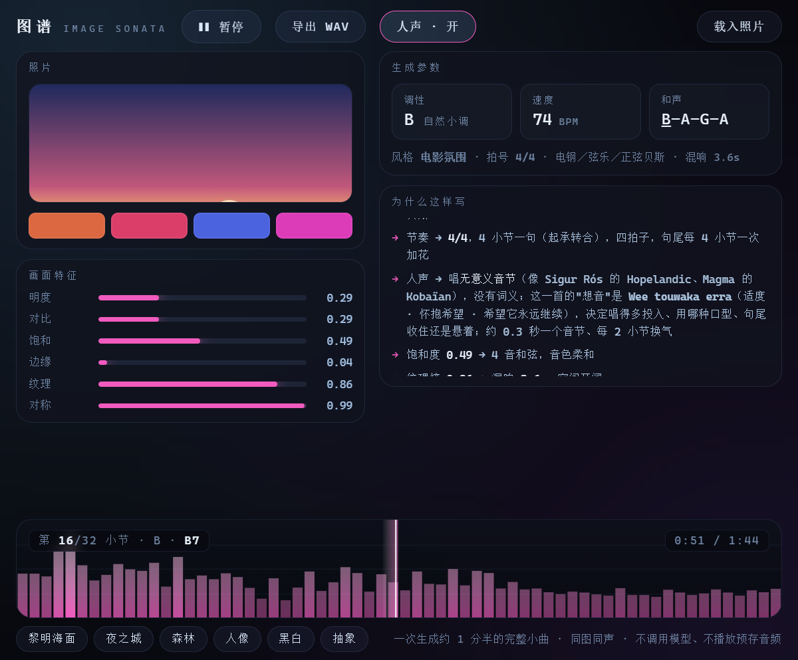

# 图谱 · IMAGE SONATA

**一张照片 → 一首一分半钟的完整小曲。有人声、有曲式、能导出 WAV。**

零依赖、无构建、单个 HTML 页面，双击就能在浏览器里跑。



---

## 它是什么

选一张照片（或者拖一张自己的），程序当场做四件事：

1. **读图**：把照片降采样到 256×256，算出亮度、对比度、饱和度、边缘密度、纹理熵、左右对称度这类客观特征。
2. **定骨架**：按固定规则把这些数字翻成音乐参数 —— 调式与主音、BPM、拍号、和声进行、曲式、音色、时长。
3. **写谱**：生成 13 类轨道的事件表（鼓、贝斯、铺底、琶音、主旋律、人声……），有前奏、A、A′、B、B′、A″、尾声，小节之间有承接和发展。
4. **发声**：用 Web Audio 实时合成，同时可以离线渲染导出 44.1 kHz 立体声 WAV。

右边那栏「为什么这样写」会把每一步换算摊开给你看：*主色相 322° → 主音 B*、*对比度 0.29 → 自然小调*、*边缘密度 0.04 → 74 BPM*。**不懂音乐也能读懂它为什么长这样。**

## 它不是什么

- **不是"图生音乐"大模型**。没有权重、没有训练、没有推理服务，全部是写在明面上的规则，任何一个参数都能指出它在哪一行。
- **不是预存音频随机播放**。所有音符都是当场算出来的，没有任何一段现成音乐。
- **同一张照片永远得到同一首曲子**。随机数只来自 `mulberry32(seed)`，而 `seed` 只由图像特征决定 —— 换台电脑、换天打开，还是那一首。

## 跑起来

```bash
# 方式一：直接双击 index.html（file:// 可用，不需要服务器）
start index.html

# 方式二：本地服务器
python -m http.server 8000
# 打开 http://127.0.0.1:8000/
```

页面底部有 6 张示例图（黎明海面 / 夜之城 / 森林 / 人像 / 黑白 / 抽象），点一张就开始；点右上「载入照片」用你自己的图。

## 界面

| 位置 | 作用 |
|---|---|
| 播放 / 暂停 | 当前这首 |
| 导出 WAV | 离线渲染整首（44.1 kHz 立体声，约 40–60 秒） |
| 人声 · 开 / 关 | 一键静音人声，只听伴奏 |
| 载入照片 | 上传图片，当场重算 |
| 生成参数 | 调性、速度、和声、风格、拍号、音色、混响 |
| 为什么这样写 | 每个参数是从画面哪一项推出来的 |
| 频谱 | 播放时才画，竖线是播放头和小节号 |

## 人声为什么不唱词

唱的是**没有意义的音节** —— 借 Sigur Rós 的 Hopelandic、Magma 的 Kobaïan 那一路做法，再从塔语（Hymmnos）借了「想音」的结构：句首带一句情绪词，句尾挂一个人称，中间才是音节。所以听起来像一种语言，但那语言不存在，也就没有版权问题。

技术上分两层：

- **元音**是真人采样（PJS 语料，5 个元音、17 条样本），用 TD-PSOLA 变调、变速。取粒时会吸附到波峰，保证相位不漂移。
- **辅音和韵尾**没有样本，全部是按频谱参数合成的噪声（塞音、擦音、近音各有自己的滤波器和时长）。

词表、咬字率、韵尾比例、转音时长这些都在 `src/js/score.js` 和 `src/js/util.js` 里，是常数，不是模型输出。

## 目录

```
index.html                页面骨架：DOM + 按依赖顺序加载的 <script>
src/css/app.css           全部样式
src/js/
  util.js                 随机数、音高/音阶换算、时间格式
  analysis.js             图像 → 特征
  mapping.js              特征 → 音乐参数
  score.js                参数 → 事件表（鼓/贝斯/铺底/琶音/旋律/人声）
  voxsample.js            人声采样引擎：TD-PSOLA 变调
  audio.js                事件 → 声音（合成器、总线、playEvent）
  player.js               实时调度与播放状态
  viz.js                  频谱与播放头
  export.js               离线渲染 + WAV 编码
  ui.js                   界面渲染、文件输入、事件绑定
  selftest.js             ?selftest=1 的客观自检
  main.js                 入口装配
assets/voicebank.js       人声音库（自动生成，不要手改）
tools/svs/                离线工具：切音库、PSOLA 自检、波形分析
research/                 调研资料（不参与运行）
AGENTS.md                 给协作者/AI 的读文件纪律与硬性约束
```

依赖只能向下走；`<script>` 的顺序就是依赖顺序。

```
util ─┬─ analysis ─┐
      ├─ mapping ──┴─ score ── audio ─┬─ player ─┐
      │                              ├─ export  ├─ ui ─ selftest ─ main
      │                              └─ viz ────┘
```

## 自检

```bash
# 起个本地服务后打开：
http://127.0.0.1:8000/?selftest=1&short=1&n=3
```

页面会打印每张图的调式/BPM/拍号/曲式/事件数/峰值/RMS/耗时，并校验 WAV 头。
判定标准：**`nan=0`、`peak < 1.0`、`WAV ... ok=true`**。

| 参数 | 作用 |
|---|---|
| `?selftest=1` | 跑全部示例 |
| `&short=1` | 只渲染前 32 拍，快很多 |
| `&n=3` | 只跑前 3 张 |
| `&voxonly=1&voxi=1` | 额外单独渲染人声，检查人声与整混音的电平比 |
| `&debug=1` | 右下角显示布局尺寸，用来查溢出 |

## 想改点什么

`AGENTS.md` 里有一张「常见改动入口」表：整首不好听、旋律、和声、节奏、人声的每一种毛病分别该动哪个文件的哪个函数，都列好了，还有踩过的坑。

排查音频的工具在 `tools/svs/`：

```bash
node tools/svs/analyze_wav.js  <wav>          # 电平、噪声、爆点
node tools/svs/probe_range.js  <wav> 16 18    # 逐 20 ms 打印音量与音高
node tools/svs/f0_blips.js     <wav>          # 全曲扫"短促的音高事件"
node tools/svs/find_blips.js   <wav>          # 全曲扫"短促的能量突起"
node tools/svs/test_psola.js                  # 变调引擎自检
```

## 已知限制

- **人声是"人声乐器"**，不是以假乱真的歌手。可懂度靠上下文，不是靠音素本身。
- **导出不是瞬间的**：离线渲染一首 1 分 40 秒的曲子，这台机器上约 40–60 秒（按钮会显示"渲染中…"）。
- **时长按 BPM × 小节数反推**，目标 84–105 秒；极快的歌偏短，极慢的偏长。
- 只在较新的 Chromium / WebKit 上验证过（需要 `OfflineAudioContext`、`StereoPannerNode`）。
- 快歌（>140 BPM）里人声音节可能短到 0.15 秒，听起来偏碎。

## 授权与致谢

- **人声采样**来自 [PJS 语料库](https://sites.google.com/site/shinnosuketakamichi/research-topics/pjs_corpus)（Pantheon Junior/Senior，**CC BY-SA 4.0**），经 `tools/svs/build_bank.py` 切分、变调后内嵌进 `assets/voicebank.js`。因此**音库及其衍生音频需要署名，并以相同方式共享**。`tools/svs/data/`（原始语料）与 `tools/svs/out/`（渲染产物）不入库。
- **无意义唱法**的参考见 `research/03-hymmnos.md`（塔语）与 `research/04-conlang-singing.md`（Hopelandic / Kobaïan）。
- 本项目代码本身尚未附许可证文件。若要用在自己项目里，建议先确认上面那条 CC BY-SA 的约束。

更多过程资料（方案的取舍、乐理诊断、人声合成的每一轮修订）在 [`research/`](./research/)。
